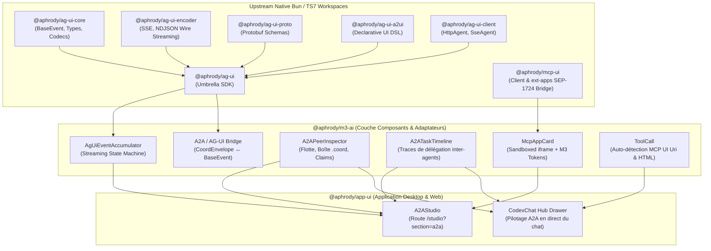

# Architecture d'Intégration AG-UI Protocol & MCP-UI dans Aphrody

Ce document définit l'architecture canonique de l'intégration native d'**AG-UI Protocol** (`https://github.com/ag-ui-protocol/ag-ui`) et de **MCP-UI** (`https://github.com/MCP-UI-Org/mcp-ui`) au sein du monorepo Aphrody.

Cette suite unifie les flux inter-agents (A2A 1.0), le streaming agent-vers-utilisateur (A2U / AG-UI) et le rendu dynamique d'interfaces génératives sandboxed (MCP Apps / MCP-UI) sur la base de Bun (>= 1.4.2), TypeScript 7 (7.0.2) et Material Design 3 (M3).

---

## 1. Vue d'Ensemble & Topologie des Paquets

L'intégration est structurée en paquets découplés respectant le graphe de dépendance et le linker isolé de Bun :



### Inventaire des packages

| Paquet | Chemin | Rôle & Responsabilité |
|---|---|---|
| `@aphrody/ag-ui` | `packages/ag-ui/packages/ag-ui` | Parapluie regroupant Core, Encoder, Proto, A2UI et Client. |
| `@aphrody/ag-ui-core` | `packages/ag-ui/packages/core` | Typages standards `BaseEvent`, `EventType`, `EventSchemas`, `RunStarted`, `ToolCall`, etc. |
| `@aphrody/ag-ui-encoder` | `packages/ag-ui/packages/encoder` | Encodeurs et décodeurs de flux SSE (`text/event-stream`) et NDJSON. |
| `@aphrody/ag-ui-proto` | `packages/ag-ui/packages/proto` | Définitions binaires Protocol Buffers pour la haute vélocité réseau. |
| `@aphrody/ag-ui-a2ui` | `packages/ag-ui/packages/a2ui` | DSL déclaratif d'interface utilisateur générée par les agents (`createSurface`, `updateComponents`, `updateDataModel`). |
| `@aphrody/ag-ui-client` | `packages/ag-ui/packages/client` | Clients HTTP, Fetch et SSE pour l'émission ou l'écoute d'agents distants. |
| `@aphrody/mcp-ui` | `packages/mcp-ui` | SDK d'hébergement d'applications MCP clientes (SEP-1724), sandbox iframe et bridge RPC bi-directionnel via `@modelcontextprotocol/client` et `@modelcontextprotocol/ext-apps`. |
| `@aphrody/m3-ai` | `packages/m3-ai` | Composants UI Material Design 3 : accumulateur d'événements, inspecteur de flotte, timeline de délégation et carte interactive d'application MCP. |
| `@aphrody/app-ui` | `packages/app-ui` | Intégration desktop native : volet de coordination A2A dans Codex Chat et studio complet `/studio` (section `a2a`). |

---

## 2. Pont Bidirectionnel A2A (Agent-to-Agent) et AG-UI (Agent-to-User)

Le protocole Aphrody A2A repose sur des enveloppes d'échange coopératives déposées dans `.coord/inbox` et `.coord/outbox` ou relayées via IPC / RPC :

```typescript
export interface CoordEnvelope {
  v?: number;
  ts: string;
  id: string;
  from: string;
  to?: string;
  kind: "ask" | "fact" | "ack" | "ping" | "error" | string;
  topic: string;
  body: string;
  re?: string;
  channel_hint?: string[];
  [key: string]: unknown;
}
```

### Mécanisme de Conversion (`AgUiEventStream.ts`)

1. **A2A `CoordEnvelope` vers AG-UI `BaseEvent`** :
   - `kind === "ask"` → Génère un `EventType.TOOL_CALL_START` avec le nom de l'agent destinataire et le topic de la requête.
   - `kind === "fact"` → Génère un `EventType.TEXT_MESSAGE_CONTENT` ou `EventType.CUSTOM` transportant le fait partagé.
   - `kind === "ack"` → Génère un `EventType.TOOL_CALL_RESULT` marquant l'étape de délégation comme complétée.
   - `kind === "error"` → Génère un `EventType.RUN_ERROR` notifiant immédiatement l'interface utilisateur.
   - Ingestion automatique des subagents : les transitions d'état créent des événements `SUBAGENT_STARTED` et `SUBAGENT_FINISHED`.

2. **AG-UI `BaseEvent` vers A2A `CoordEnvelope`** :
   - Permet à une action déclenchée depuis l'interface utilisateur ou un subagent web de déposer une enveloppe signée dans la boîte de coordination d'un pair (par exemple déléguer à `codex` ou `claude`).

---

## 3. Accumulateur d'Événements (`AgUiEventAccumulator`)

Le moteur `AgUiEventAccumulator` implémente une machine à états capable d'absorber en temps réel des fragments d'événements asynchrones désordonnés et de fournir un instantané synchronisé (`AgUiStreamState`) consommable par les composants React :

```typescript
const accumulator = new AgUiEventAccumulator();

// Ingestion au fil de l'eau
accumulator.push({ type: EventType.RUN_STARTED, timestamp: Date.now() });
accumulator.push({ type: EventType.TEXT_MESSAGE_CONTENT, delta: "Analyse en cours..." });
accumulator.push({
  type: EventType.TOOL_CALL_START,
  toolCallId: "call_01",
  toolCallName: "system_probe",
});
accumulator.push({
  type: EventType.TOOL_CALL_RESULT,
  toolCallId: "call_01",
  content: { memoryFreeMb: 8192 },
});
accumulator.push({ type: EventType.RUN_FINISHED });

// Extraction d'un snapshot typé
const state = accumulator.snapshot();
// state.steps -> TranscriptStep[]
// state.items -> TranscriptItem[] (paires tool_call + tool_result, texte, etc.)
// state.a2uiSurfaces -> Surfaces générées A2UI prêtes pour le rendu
```

---

## 4. MCP Apps & Isolation Sandboxée (SEP-1724)

Les outils MCP d'Aphrody peuvent exposer des vues graphiques interactives via la métadonnée `_meta.ui.resourceUri` ou en renvoyant directement du code HTML.

### Architecture de Sécurité et Injection de Thème (`McpAppCard.tsx`)

1. **Isolation `iframe` stricte** :
   L'attribut `sandbox="allow-scripts allow-forms allow-same-origin"` garantit que le code UI généré par l'outil ou le modèle ne peut ni accéder aux cookies maîtres, ni manipuler le DOM parent de l'application desktop.

2. **Transmission Dynamique des Tokens M3** :
   À chaque chargement de l'iframe, un message `postMessage` transmet la configuration de thème active :
   ```json
   {
     "type": "aphrody:m3-theme-sync",
     "colorScheme": "dark",
     "tokens": {
       "primary": "#d0bcff",
       "surface": "#141218",
       "onSurface": "#e6e1e5",
       "primaryContainer": "#4f378b"
     }
   }
   ```
3. **Bridge RPC MCP (`@aphrody/mcp-ui`)** :
   Grâce aux modules officiels `@modelcontextprotocol/client` et `@modelcontextprotocol/ext-apps`, l'application sandboxée peut émettre des requêtes RPC vers le serveur MCP de façon hermétique.

---

## 5. Règles de Performance & Compatibilité

- **Zéro polyfill Node.js** : Utilisation exclusive des APIs standards web (`fetch`, `ReadableStream`, `TransformStream`, `EventSource`) et des primitives natives Bun (`Bun.serve`, `bun:ffi`).
- **Compatibilité TypeScript 7** : Conforme à `ts 7.0.2` avec suppression stricte de `baseUrl` au profit des alias d'importation `"paths": { "@/*": ["./src/*"] }`.
- **Ressources Système** : Vérifications de compilation Rust sérialisées via `scripts/build/rust/cargo-serial.sh` sous verrou global partagé.
