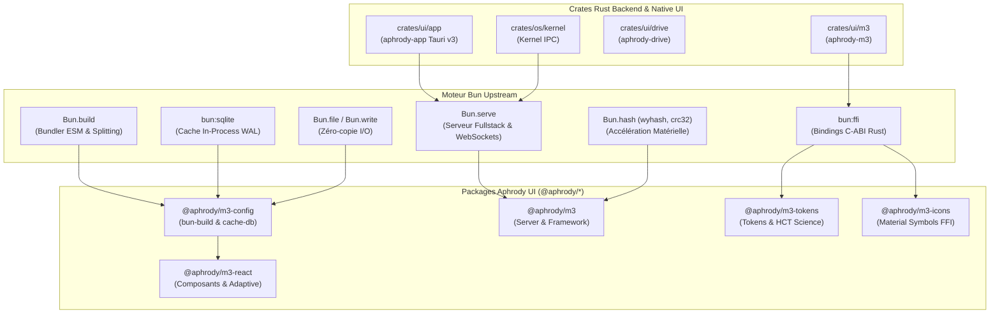

<!-- SPDX-License-Identifier: Apache-2.0 -->

# Architecture Aphrody UI & Alignement Bun Upstream

> **Document d'Architecture Canonique**  
> Périmètre : Interface Utilisateur (UI/GUI), Web, Desktop (Tauri v3), Scripts, Infra, Packages et Crates de tout Aphrody.  
> Source de référence upstream : upstream `oven-sh/bun` (the Aphrody fork was deleted on 2026-10-02) through `aphrody git upstream` for oven-sh/bun (Bun v1.4+).

---

## 1. Vision et Principes Fondateurs

L'écosystème Aphrody unifie ses surfaces d'interface utilisateur (Desktop Tauri v3, Web Fullstack, Widgets, Chat et Outils de création) autour d'une architecture orientée **Bun-First** et **Backend-Native** :

1. **Zéro Hardcoding & Calquage Backend Réel** :  
   L'UI n'invente aucune donnée, texte ou état fictif. Toutes les fonctionnalités, statuts de sous-systèmes, listes de modèles, métriques d'agents et topologies de stockage sont calqués sur les contrats natifs du runtime :
   - FFI (`@aphrody/bun` / `packages/m3`)
   - Moteur App-Server JSON-RPC 2.0 (`crates/ai/app-server`)
   - Noyau OS & sous-systèmes IPC (`crates/os/kernel`)
   - Système de stockage VDFS et daemon supervisé (`crates/ui/drive`, `crates/os/drive`, `sd-daemon`)
   - Moteurs spécialisés Koharu (Vision/OCR in-process) et Shenron (RAG ancré `dragonballfr.com`)
   - Shell NuShell interactif avec PTY (`crates/shell`)

2. **Parité Bilingue Symétrique Stricte (EN / FR)** :  
   Toutes les clés de traduction sont organisées en namespaces sémantiques dérivés des piliers d'architecture (`common`, `nav`, `chat`, `files`, `models`, `settings`, `kernel`, `subsystems`, `drive`, `koharu`, `shenron`, `shell`, `ffi`, `errors`). Aucun texte n'est injecté sans passer par le générateur automatique et l'audit de parité stricte 1:1.

3. **Exploitation Intégrale des Primitives Bun Upstream** :  
   Élimination progressive des wrappers Node.js redondants au profit des primitives natives C++/Zig/Rust de Bun :
   - Bundler natif `Bun.build` avec splitting, sourcemaps et gestion du flag `'use client';`
   - Serveur fullstack `Bun.serve` avec routage déclaratif, streaming zéro-copie `Bun.file`, compression `Bun.gzipSync` et hachage ETag `Bun.hash.wyhash`
   - Cache d'exécution SQLite in-process via `bun:sqlite` (mode WAL) pour les thèmes, tokens, icônes et métadonnées
   - Accélération matérielle SIMD (`Bun.hash.crc32`)
   - Duplex temps réel via WebSocket natif (`server.upgrade`)

---

## 2. Structure du Monorepo et Conventions Bun

### 2.1 Hiérarchie des Espaces de Travail (Workspaces)

```
aphrody/
├── apps/                         # Applications exécutables
│   ├── cli/                      # CLI unifiée Aphrody (9 piliers)
│   ├── koharu/editor/            # Éditeur de documents Koharu (Tauri / CEF)
│   └── shenron/                  # Applications web & chat Shenron
├── crates/                       # Crates Rust de premier ordre
│   ├── ai/app-server/            # Serveur d'orchestration agentique
│   ├── os/kernel/                # Noyau IPC et sous-systèmes OS
│   └── ui/                       # Composants et applications graphiques natifs
│       ├── app/                  # Application Desktop principale aphrody-app (Tauri 3)
│       ├── drive/                # Plugin Tauri aphrody-drive
│       ├── m3/                   # Implémentation Rust du design system Material 3
│       └── tauri-wrap/           # Abstraction d'exécution webview Wry / CEF
├── packages/                     # Packages TypeScript / Bun de premier ordre
│   ├── bun/test-dom/             # Environnement de test DOM isolé
│   ├── infra/workspace/          # Orchestrateur monorepo (@aphrody/workspace)
│   ├── interop/native/           # Bindings FFI Bun vers Rust (@aphrody/bun)
│   └── ui/                       # Suite Material 3 et utilitaires graphiques
│       ├── m3/                   # Coeur de framework M3 pour Bun
│       ├── m3-ai/                # Composants d'interface conversationnelle et markdown
│       ├── m3-config/            # Presets de configuration, bun-build et cache SQLite
│       ├── m3-explorer/          # Navigateur de fichiers et grille de tuiles
│       ├── m3-forms/             # Champs et validation de formulaires
│       ├── m3-icons/             # Icônes Material Symbols avec pont FFI
│       ├── m3-motion/            # Éasings, durées et ressorts physiques WAAPI
│       ├── m3-next/              # Intégration Next.js / SSR
│       ├── m3-primitives/        # Primitives UI accessibles (Base UI / Radix)
│       ├── m3-react/             # Wrappers React 19 et hooks adaptatifs
│       ├── m3-reader/            # Visionneuses de documents et mangas
│       ├── m3-theme/             # Moteur de thèmes dynamiques HCT et classes CSS
│       ├── m3-tokens/            # Synthèse et extraction des design tokens
│       ├── material-web/         # Fork des web components Lit originaux
│       ├── scaffold/             # Générateur de projets d'applications
│       └── web-to-tauri/         # Moteur de conversion Web vers Tauri 3
├── scripts/                      # Scripts d'outillage, audit, dev et build
│   ├── audit/                    # Audits de conformité monorepo, bundles et i18n
│   ├── build/                    # Scripts de compilation sérialisés et presets
│   ├── dev/ui/                   # Serveurs de développement persistants
│   └── tools/ui/                 # Générateurs automatisés
└── docs/                         # Documentation canonique (9 catégories)
```

### 2.2 Règles de Manifestes (`package.json`)

Chaque package sous `packages/` et application sous `apps/` respecte les règles du gate Bun (`bun run bun:check`) :
- `private: true` pour les packages internes du monorepo.
- `engines.bun`: `>=1.4.2` aligné sur le `packageManager` racine.
- Pas de champ `packageManager` dans les sous-packages (uniquement à la racine).
- Dépendances partagées déclarées via le catalogue central : `"catalog:"`.
- `type: "module"` avec imports ESM natifs.
- Scripts stricts : aucune commande appelant un outil étranger (`npm`, `npx`, `yarn`, `pnpm`, `node`).
- Présence obligatoire d'un script `typecheck` pour les packages possédant un `tsconfig.json`.

---

## 3. Piliers d'Implémentation Bun Upstream



### 3.1 Bundling Natif (`@aphrody/m3-config/bun-build`)

Au lieu de dépendre d'outils tiers, la suite UI utilise le preset de build natif `m3BunBuild` :
- **Entrées configurables** : génération simultanée de plusieurs points d'entrée (`src/index.ts`, `src/react.tsx`, etc.).
- **Préservation `'use client'`** : analyse du graphe et injection automatique de la directive React 19 pour les composants interactifs.
- **Exclusion automatique du scope externe** : `react`, `react-dom`, `lit`, `motion`, `tailwindcss`, `@aphrody/*`.
- **Sourcemaps externes** et splitting de code ESM natif.

### 3.2 Cache Haute Vitesse In-Process (`bun:sqlite`)

Le module `M3UiCache` (`@aphrody/m3-config/cache-db`) fournit une couche de persistance sans latence réseau ni subprocess :
- Mode WAL activé (`PRAGMA journal_mode = WAL; PRAGMA synchronous = NORMAL;`).
- Stockage typé sous `(namespace, key)` avec timestamp de mise à jour.
- Utilisé pour mettre en cache les calculs colorimétriques HCT, les rendus vectoriels d'icônes, les feuilles de style de tokens et les préférences de session.
- Instance partagée persistante sous `~/.aphrody/cache/ui.sqlite` avec fallback en mémoire pour les tests.

### 3.3 Serveur Desktop Persistant & Pont Tauri Universel (`Bun.serve`)

Le serveur persistant [`scripts/dev/ui/serve-desktop-ui.ts`](https://github.com/aphrody-labs/aphrody/blob/main/scripts/dev/ui/serve-desktop-ui.ts) écoute sur le port officiel Tauri `1421` :
- **Pont IPC Tauri Transparent** : injection automatique dans `index.html` de `window.__TAURI_INTERNALS__` et `window.__TAURI__` (core `invoke`, event `listen`/`emit`), permettant à l'application web d'exécuter nativement toutes les commandes Tauri de bureau sans runtime Wry externe.
- **Dispatching de Commandes Natives (`/api/tauri/invoke`)** : prise en charge complète de `aphrody_meta`, `aphrody_hardware_telemetry`, `aphrody_model_*`, `aphrody_fs_*`, `aphrody_shenron_chat`, `koharu_rpc`, `aphrody_rpc`.
- **Routage SPA** : redirection transparente de toutes les routes de vues (`/chat`, `/files`, `/models`, `/settings`, `/splash`, `/pet`, etc.) vers `crates/ui/app/ui-dist/index.html`.
- **ETags wyhash** : calcul d'empreinte ultra-rapide via `Bun.hash.wyhash` et réponses instantanées `304 Not Modified`.
- **Compression transparente** : compression à la volée via `Bun.gzipSync` pour les assets supérieurs à 1 Ko.
- **Canal WebSocket Duplex (`/ws`)** : synchronisation en temps réel de l'état des sous-systèmes, télémétrie matérielle et diffusion d'événements.
- **APIs dynamiques** :
  - `/health` : statut, uptime, révision Bun et capacités actives
  - `/api/apps` : registre unifié de toutes les applications du monorepo (`aphrody-app`, `koharu`, `rg-website`, `shenron-site`, `cli`, `m3-framework`)
  - `/api/capabilities` : inventaire exhaustif et dynamique des piliers natifs
  - `/api/i18n` et `/api/i18n/:lang` : catalogues bilingues synchronisés
  - `/api/tokens` : variables et métadonnées du système de design Material 3
  - `/api/cache/stats` : métriques du cache SQLite embarqué

---

## 4. Stratégie de Compilation et Qualité

### 4.1 Gates Automatisées

L'alignement est vérifié en continu via les suites d'audit du monorepo :

```bash
# Vérification des manifestes et de la conformité Bun
bun run bun:check

# Vérification du layout du monorepo et de l'isolation des sources
bun run monorepo:layout

# Vérification des projets Tauri v3
bun run tauri:apps:check

# Qualification des bundles navigateurs (zéro dépendance Node/FFI dans les bundles browser)
bun run ui:browser-audit

# Audit de parité 100% symétrique EN / FR
bun run i18n:audit

# Tests unitaires des composants et du serveur
bun test packages/m3-config/test/
bun test scripts/dev/ui/serve-desktop-ui.test.ts
```

### 4.2 Politique de Sérialisation Cargo

Conformément à `GEMINI.md` :
- Les agents et workers ne lancent jamais directement de commandes `cargo` concurrentes.
- Toute compilation ou vérification Rust passe obligatoirement par le wrapper de verrouillage sérialisé :
  ```bash
  scripts/build/rust/cargo-serial.sh check -p aphrody-app
  ```
- Les caches `sccache` et Cargo partagés sont strictement préservés.
